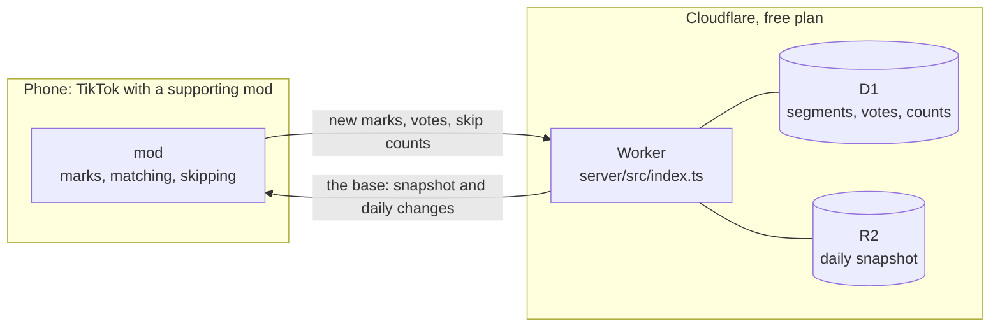

# SponsorBlock for TikTok

Skip ads inside TikTok videos by their sound. Someone marks an ad once, and every phone with a
supporting mod skips it in every video where the same sound plays again, even under a voice-over,
re-encoded, or sped up a little.

This repository is the shared side that any TikTok mod can plug into. It has no TikTok or mod
code of its own:

- **[`server/`](server)**: the shared ad base, a Cloudflare Worker with D1 and R2 that stores
  marked ads, takes votes and serves the whole base to phones once a day.
- **[`core/`](core)**: a dependency-free Java 11 library that fingerprints audio, cuts a marked
  ad out of a video's fingerprint and finds marked ads in new videos.
- **[`docs/`](docs)**: how the matching works, the HTTP API and the snapshot format, what a mod
  has to hook to support it, and what data leaves the phone.

> Unofficial. Not affiliated with [SponsorBlock](https://sponsor.ajay.app) or TikTok. The name
> only says what it does: SponsorBlock-style skipping, for TikTok.

## How it works, in short

1. A viewer sees an ad inside a video and marks it in their mod.
2. The mod decodes the video's sound, the viewer drags the start and end over it, and the core
   library turns that stretch into audio landmarks: pairs of spectrogram peaks packed into
   32-bit hashes, the way Shazam identifies songs.
3. The ad's landmarks go to the shared base. No audio is uploaded, and the hashes cannot be
   turned back into sound.
4. Every phone downloads the base once a day. When a video starts, the mod fingerprints its
   sound and the matcher looks for any marked ad in it. A match is skipped when playback
   reaches it.
5. Viewers vote on what was skipped. A segment with too many down-votes is hidden from every
   phone at their next sync.

The details are in [docs/how-it-works.md](docs/how-it-works.md).

## How a mod uses it

A mod does the phone side: it hooks TikTok's player, decodes the sound, matches it against the
base and skips. This server only stores the marks, the votes and the counts, and talks to mods
over HTTPS.



A mod still works without the server, with only the viewer's own marks. Any mod that speaks
[the API](docs/api.md) can use the public base, and anyone can run their own copy, see
[server/README.md](server/README.md).

## Mods that support it

| Mod | Where |
| --- | --- |
| Metra, **Skip ads by sound** patch | [MidTano/metra-tiktok-sponsorblock](https://github.com/MidTano/metra-tiktok-sponsorblock), installed through Morphe Manager |

What the viewer gets depends on the mod. What a mod sends to the public base is listed in
[docs/privacy.md](docs/privacy.md).

## For mod developers

Adding sound-based ad skipping to your mod takes four hooks: the video's playback position,
a way to seek, the decoded audio of the current video, and an entry point for marking. The core
library does the rest. Start with [docs/integrating.md](docs/integrating.md).

You can use the public base at `https://metra-adskip.falker600.workers.dev` or run your own; the
API is in [docs/api.md](docs/api.md) and the deployment steps in
[server/README.md](server/README.md). A shared base works better the more mods feed it, so
using the public one is encouraged.

## Building

```sh
./gradlew :core:build          # library and its tests (JDK 21 toolchain, Java 11 bytecode)
cd server && npm ci && npm run typecheck && npm test
```

## Contributing

Read [CONTRIBUTING.md](CONTRIBUTING.md). Security problems go through
[SECURITY.md](SECURITY.md), not public issues. Bad segments in the public base can be reported
with the **Bad segment** issue form.

## License

GPL-3.0, see [LICENSE](LICENSE) and [NOTICE.md](NOTICE.md).
