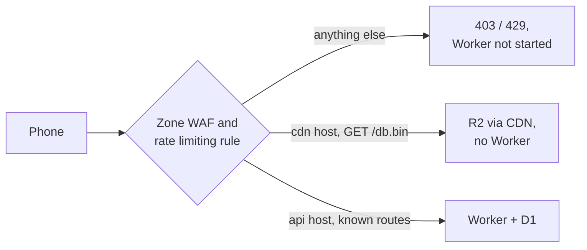

# Server

A Cloudflare Worker ([`src/index.ts`](src/index.ts)) with a D1 database for segments, votes and
counters and an R2 bucket for the daily snapshot. Designed for economical use on the Workers
free plan: phones sync once a day and write rarely. Capacity depends on measured load.

## Running your own

1. `npm install`, then `npx wrangler login`.
2. Create the database and bucket:
   ```sh
   npx wrangler d1 create <db-name>
   npx wrangler r2 bucket create <bucket-name>
   ```
3. In [`wrangler.jsonc`](wrangler.jsonc) set `name`, the custom domain in `routes`, `account_id`, `database_name`, `database_id` and `bucket_name`. The rate-limit
   `namespace_id` values only need to be unique within your account.
4. Apply the migrations, in order:
   ```sh
   npx wrangler d1 migrations apply <db-name> --remote
   ```
5. Set the two secrets, random values nobody else knows:
   ```sh
   node -e "process.stdout.write(require('crypto').randomBytes(32).toString('hex'))" | npx wrangler secret put IP_SALT
   node -e "process.stdout.write(require('crypto').randomBytes(32).toString('hex'))" | npx wrangler secret put USER_SECRET
   ```
   `IP_SALT` keys the network hashes; changing it only resets the daily counters and per-network vote checks.
   `USER_SECRET` keys the account hashes; changing it makes every account new.
6. `npx wrangler deploy`.

For local development, `npx wrangler dev` with a `.dev.vars` file holding `IP_SALT=...` and
`USER_SECRET=...`, and the migrations applied with `--local`.

## Pointing a mod at your server

Every mod keeps the server address in its own code; point it at your `https://api.<zone>` and
`https://cdn.<zone>/db.bin` and build the mod again. In Metra they are `BASE_URL` and `SNAPSHOT_URL` near
the top of `extensions/tiktok/src/main/java/app/morphe/extension/tiktok/adskip/SharedDb.java`.

## Limits

| What | Limit |
| --- | --- |
| Submissions | 5 a minute per address, 20 a day per account, 60 a day per address, 300 a day across the base |
| Votes | 30 a minute per address; 300 changes a UTC day per account, 600 per address; 50 down-votes a UTC day per address; 4 changes a day to one vote |
| Downloads | 60 a minute per address; deltas the cache cannot answer, 10 a minute |
| Skip reports | 2 a day per account |
| A segment | 1 to 30 s, 40 to 6,000 hashes |

Per-minute limits use Workers rate-limit bindings, which only take 10 or 60 second windows;
daily limits are counted in D1. An IPv6 client counts as its /48 for writes, votes and bans
(free tunnel brokers hand out a whole /48) and as its /64 for read bursts.

`admin.mjs unhide` pins a segment: votes no longer hide it until `hide` removes it.

## Moderation

[`scripts/admin.mjs`](scripts/admin.mjs) runs SQL through Wrangler, so whoever is logged in to
the Cloudflare account that owns the Worker is the admin. There is no admin route on the
Worker to attack.

```sh
node scripts/admin.mjs list [--hidden]     # newest 50 segments
node scripts/admin.mjs show 12             # ad12 and its votes
node scripts/admin.mjs hide 12             # off every phone at the next sync
node scripts/admin.mjs unhide 12
node scripts/admin.mjs ban 12 "spam"       # ban whoever sent ad12, hide all they sent
node scripts/admin.mjs unban 12
node scripts/admin.mjs export-user 12     # everything the sender of ad12 added, as JSON
node scripts/admin.mjs delete-user 12
node scripts/admin.mjs stats
```

Edit `DATABASE` and `BUCKET` at the top of the script for your own instance.

## Staying on the free plan

The free plan gives, per account and UTC day: 100,000 Worker requests; for D1, 5 million rows read
and 100,000 rows written (an index on a written column adds a row), with 5 GB stored; for R2,
10 GB stored, 1 million writes and 10 million reads a month, and no egress fees. Since September
2026, D1 refuses queries for the rest of the UTC day once a limit is passed; phones then keep
skipping with what they have and send their counts later.

What keeps a phone cheap:

- **Workers Caching** (`"cache": { "enabled": true }` in `wrangler.jsonc`) answers
  `/v1/db/since` and `/v1/stats` from Cloudflare's cache until a minute past the
  next daily run at 01:00 UTC, without running the Worker, so a hit costs no D1 or R2 reads. A hit
  still counts as a Worker request. Each deployment starts with an empty cache. Check it with
  `curl -sI <url>` twice: the second answer says `cf-cache-status: HIT`.
- **Whole-hour deltas.** A delta answers as of the start of the hour, so every phone asks with one
  of a few dozen `t` values and most deltas come from the cache.
- **One row per skip report.** A report keeps its counts as JSON in one `skip_reports` row; the
  daily run adds them to the segments in a single statement.
- **Daily maintenance**, at 01:00 UTC, merges reports, refreshes totals, clears old records and
  publishes the snapshot. No hourly idle checks.
- **The phone asks rarely** (Metra from v0.12.2): the base once a day, skip counts once a day and only when it
  skipped something, statistics once a day and only when the list is open, in one
  request (`/v1/me` carries the totals). Pending votes send their latest value at daily sync;
  local down-votes and undo apply immediately. A newly marked ad can upload immediately.

A rough budget for one daily phone, as an estimate:

| What the phone does | Requests | D1 rows written |
| --- | --- | --- |
| Daily sync | 1 | 0 |
| Skip counts, once a day | 0–1 | report insertion, later merge and cleanup; depends on segments covered |
| Statistics, when the list is opened | 0–1 | 0 |
| Marking an ad or voting, now and then | 1 each | about 7 per mark, 6 per vote |

Report insertion/cleanup is **not the whole cost**. The daily merge also
writes every distinct segment touched by those reports, and statistics refreshes read the whole
segments table. Two reports covering 200 different segments each can therefore cause roughly
400 segment updates in addition to report storage and shared maintenance. Index maintenance adds
cost when indexed columns change. There is no defensible fixed daily-user capacity without measurements.

Measure Worker requests separately from D1 SQL queries, rows read and rows written. One phone
request can execute several statements and read many rows; scheduled maintenance and manual
exports also contribute even with one phone. The normal client budget is one daily download
(possibly several delta pages), at most one nonempty report and one statistics fetch per day
when the list is opened: normally up to three requests without submissions or pending votes.
Submissions, queued votes and older installed clients add traffic. Automatic failed sync/statistics
attempts wait 24 hours, including across restarts; concurrent statistics loads are coalesced.
Versions before v0.12.2 report twice a day and refresh statistics hourly while the list is open;
the server still accepts two reports a day for them.

Never publicly cache `/v1/me`, writes, errors or anything keyed by a token, and do not add a
blanket Cache Everything rule for the API.

## Protecting a public instance

The limits in the Worker run only after the Worker starts, and on the free plan every started
Worker counts towards the 100,000 requests a day, `429` answers included. One address at the
per-minute read limit sends about 86,000 requests a day, so without a firewall a single client can
use up the day's quota and stop the base for everyone until 00:00 UTC.

`workers.dev` has no WAF, so it is off (`"workers_dev": false`). A request that a WAF rule blocks never starts the Worker and costs
nothing. The public instance is set up like this, all on the Free plan:



1. A free domain (`sponblocktikitoki.dpdns.org`, DigitalPlat) is a Cloudflare zone on the Free plan.
2. The Worker is a Custom Domain on `api.<zone>` (`routes` in `wrangler.jsonc`).
3. The R2 bucket is a Custom Domain on `cdn.<zone>`, with a Cache Rule that keeps it at the edge
   for 2 hours. Phones take the full snapshot from there, so the base still reaches them on a
   day the Worker is over its quota.
4. **Security → WAF → Custom rules** (four of the five on Free), all **Block**:
   - `not http.host in {"api.<zone>" "cdn.<zone>"}`
   - `http.host eq "api.<zone>" and http.request.uri.path ne "/v1/health" and not any(len(http.request.headers["x-sb-token"][*])[*] eq 43)`
   - `http.host eq "api.<zone>" and not ((http.request.method in {"GET" "HEAD"} and http.request.uri.path in {"/v1/health" "/v1/stats" "/v1/me" "/v1/db/since"}) or (http.request.method eq "POST" and (http.request.uri.path in {"/v1/segments" "/v1/skips"} or (starts_with(http.request.uri.path, "/v1/segments/") and ends_with(http.request.uri.path, "/vote"))))) or (http.host eq "api.<zone>" and http.request.uri.query ne "" and http.request.uri.path ne "/v1/db/since")`
   - `http.host eq "cdn.<zone>" and (http.request.uri.path ne "/db.bin" or http.request.uri.query ne "" or not http.request.method in {"GET" "HEAD"})`
5. **Security → WAF → Rate limiting rules** (the one rule on Free): `http.host eq "api.<zone>"`,
   by IP and data center, 15 requests per 10 seconds, block for 10 seconds.
6. Zone settings: SSL Full (strict), Always Use HTTPS, minimum TLS 1.2, Security Level
   essentially off and Browser Integrity Check off. Do not turn on Bot Fight Mode or Under Attack
   Mode: their browser challenges stop phones.

What this does not stop: a slow flood from many addresses that looks like real phones still starts
the Worker and can use up the day's 100,000 requests. Phones then still get the snapshot from the
CDN; only sending marks, votes and the statistics card wait for 00:00 UTC.

For scale: on 25 November 2026, with one phone on the old hourly schedule, the public instance
used 75 Worker requests, 270 D1 queries, 3,173 rows read and 226 rows written in the day, which
is under 0.3% of every free-plan daily limit. Most of it was the 24 hourly runs and the
maintainer's own checks, not the phone.

Watch the numbers under **Workers & Pages → your Worker → Metrics** and **D1 → your database →
Metrics**. Your own `wrangler d1 execute` and `d1 export` runs count too: an export reads every
row.
